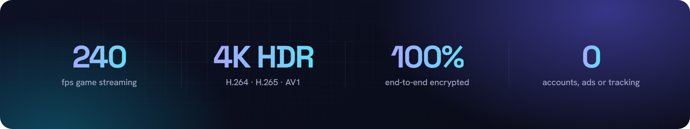
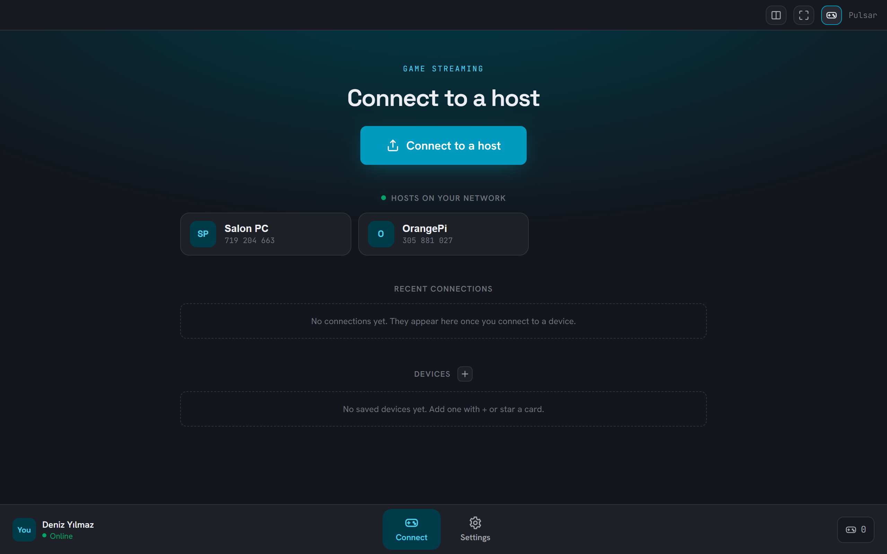
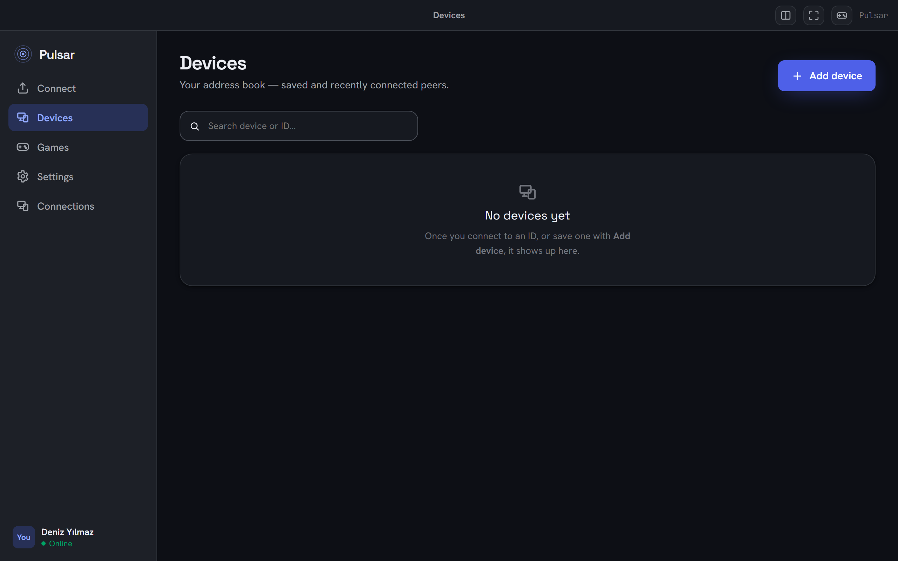

<p align="center">
  <a href="https://pulsardesk.com"></a>
</p>

<h3 align="center">Free, open-source remote desktop and game streaming.</h3>

<p align="center">
  The TeamViewer, AnyDesk and Parsec alternative with <b>no account</b>, <b>no subscription</b> and <b>no tracking</b>.<br>
  One app for Windows, macOS and Linux. Help a friend, reach your own PC, or play your games from another room.
</p>

<p align="center">
  <a href="https://github.com/PulsarDesk/pulsar-desktop/releases/latest"></a>
  <a href="https://github.com/PulsarDesk/pulsar-desktop/releases/latest"></a>
  <a href="https://github.com/PulsarDesk/pulsar-desktop/releases/latest"></a>
  <a href="https://github.com/PulsarDesk/pulsar-mobile/releases/latest/download/Pulsar-android.apk"></a>
</p>

<p align="center">
  <a href="https://github.com/PulsarDesk/pulsar-desktop/releases"></a>
  <a href="https://github.com/PulsarDesk/pulsar-desktop/actions/workflows/ci.yml"></a>
  <a href="https://github.com/PulsarDesk/pulsar-desktop/releases"></a>
  <a href="https://github.com/PulsarDesk/pulsar-desktop/stargazers"></a>
  <a href="LICENSE"></a>
</p>

<p align="center">
  <a href="https://pulsardesk.com"><b>Website</b></a> ·
  <a href="#-get-pulsar"><b>Download</b></a> ·
  <a href="#-questions"><b>FAQ</b></a> ·
  <a href="https://github.com/PulsarDesk/pulsar-mobile"><b>Android app</b></a> ·
  <a href="https://github.com/PulsarDesk/pulsar-desktop/issues/new/choose"><b>Report a bug</b></a>
</p>

<br>

<p align="center"></p>

## 💜 Why Pulsar?

<table>
<tr>
<td width="33%" valign="top">

### 🆓 Free. Really.
No trial, no "personal use only", no time limit on sessions and no account to create. Pulsar is open source
(GPLv3), so it stays free.

</td>
<td width="33%" valign="top">

### 🔒 Private by design
Every session is end-to-end encrypted, always. Even the server that helps you connect only sees scrambled data.
No telemetry, no ads.

</td>
<td width="33%" valign="top">

### 🎮 Made for games
Up to 4K and 240 fps with HDR, a picture that adapts to your Wi-Fi, and your controller works like it is plugged
into the other PC. A real DualSense, triggers and all.

</td>
</tr>
<tr>
<td width="33%" valign="top">

### ⚡ Fast by default
Pulsar connects your two devices directly whenever it can, so nothing sits in the middle slowing you down. When a
direct path isn't possible, it falls back to a relay automatically.

</td>
<td width="33%" valign="top">

### 🗂️ Tabs, like a browser
Open several computers at once. Drag a session into its own window, drop it next to another, or view two side by
side.

</td>
<td width="33%" valign="top">

### 🏠 Yours to run
Want everything on your own hardware? Run your own [Pulsar server](https://github.com/PulsarDesk/relay) with one
command. The apps work with it out of the box.

</td>
</tr>
</table>

## 👀 A look inside

<table>
<tr>
<td width="50%"></td>
<td width="50%"></td>
</tr>
<tr>
<td align="center"><b>Connect</b> · share your ID or type someone else's</td>
<td align="center"><b>Game mode</b> · a living-room view for your controller</td>
</tr>
<tr>
<td width="50%"></td>
<td width="50%"></td>
</tr>
<tr>
<td align="center"><b>Settings</b> · quality, codec and HDR in plain words</td>
<td align="center"><b>Devices</b> · your computers, one click away (dark theme)</td>
</tr>
</table>

## 🚀 How it works

<p align="center"></p>

That's it. No port forwarding, no sign-up, no IP addresses to look up. Devices on the same network even show up on
their own.

## ✨ What you can do

### 🎮 Play your gaming PC from anywhere
- **Sharp and smooth:** up to **4K** and **240 fps** (120, 144 and 165 Hz screens too), with **10-bit HDR**.
- **Feels local:** hardware video on both sides and a picture drawn the moment it arrives, so the delay stays tiny.
- **Never a frozen screen:** Pulsar tests your connection first, then keeps adjusting so busy Wi-Fi or a phone
  hotspot stays playable.
- **Looks better than it is:** AMD FSR, NVIDIA RTX and Intel video upscaling sharpen a lower-resolution stream.
- **Your controller, for real:** Xbox, PlayStation and Switch Pro pads work. A DualSense keeps its adaptive
  triggers, haptics, lightbar, speaker, mic and headset jack, just like on a PS5. [More on controllers](#-controllers)
- **Wake it with the PS or Xbox button**, and play with the game's sound while the host's speakers stay quiet.
- **Couch co-op on one PC** (advanced): split the screen and give every player their own game and controller.
- **Living-room box:** a dedicated build for the Orange Pi 5 turns a tiny board into a game-streaming client.

### 🖥️ Help, support and work remotely
- **Remote control** of the whole desktop, on any monitor you pick.
- **Send files** both ways with a built-in file manager, or just drag and drop.
- **Copy here, paste there:** the clipboard follows you between computers.
- **Chat and talk:** text chat and your microphone, in the same session.
- **You stay in charge:** the person at the computer sees who is connected and can take control back with one
  click. Need to swap roles? Switch sides in one click.
- **Several computers at once** in tabs or split screen.

### 🔒 Safe by default
- **Always encrypted end to end,** with a modern key exchange that keeps past sessions safe.
- **You decide who gets in:** a one-time password, a fixed password, an on-screen Allow / Deny prompt, trusted
  devices, and two-factor codes for all of them.
- **Unattended access** for your own machines, when you turn it on.
- **Works through home routers and VPNs** (ZeroTier, Tailscale and others) without touching router settings.

## 📥 Get Pulsar

Grab the installer for your computer from the **[latest release](https://github.com/PulsarDesk/pulsar-desktop/releases/latest)**,
or let [pulsardesk.com](https://pulsardesk.com) pick the right one for you.

| Your computer | Download |
|---|---|
| 🪟 **Windows** 10 / 11 | `_x64-setup.exe` (or `_arm64-setup.exe` for ARM laptops) |
| 🍎 **macOS** | `_aarch64.dmg` for Apple Silicon, `_x64.dmg` for Intel Macs |
| 🐧 **Linux** | `.AppImage`, `.deb` or `.rpm` (x64 and arm64) |
| 🍊 **Orange Pi 5** (RK3588) | `_opi5_arm64.deb`, with hardware video (Ubuntu 22.04 + `ppa:jjriek/rockchip-multimedia`) |
| 📱 **Android** | [`Pulsar-android.apk`](https://github.com/PulsarDesk/pulsar-mobile/releases/latest/download/Pulsar-android.apk) ([Pulsar Mobile](https://github.com/PulsarDesk/pulsar-mobile)) |

Then open Pulsar, tell the other side your **ID and one-time password**, or type theirs and press **Connect**.
Pulsar keeps itself up to date.

> [!NOTE]
> Pulsar is new, so the installers aren't signed yet.
> **Windows:** if SmartScreen warns, choose *More info* → *Run anyway*.
> **macOS:** right-click the app → *Open* the first time.
> **Linux on Wayland:** the system asks once per session before your screen is shared.

## ❓ Questions

<details>
<summary><b>Is it really free?</b></summary>
<br>
Yes. Pulsar is free and open-source software under the GPLv3 license. There is no paid tier, no feature locked
behind a subscription, and no "commercial use detected" pop-up.
</details>

<details>
<summary><b>Do I need an account?</b></summary>
<br>
No. Each device gets an ID automatically. You share the ID and a one-time password, and that's all.
</details>

<details>
<summary><b>Can someone else see my screen or my data?</b></summary>
<br>
No. Every session is end-to-end encrypted. When the connection goes through a relay server, that server only
forwards data it cannot read. Pulsar sends no telemetry.
</details>

<details>
<summary><b>Do I have to open ports on my router?</b></summary>
<br>
No. Pulsar finds a direct path through most home routers on its own (and opens one automatically with UPnP /
NAT-PMP when your router allows it). If no direct path exists, it uses the relay automatically.
</details>

<details>
<summary><b>Is it good enough for games?</b></summary>
<br>
That's what it was built for: hardware encoding and decoding, H.264 / H.265 / AV1, HDR, up to 240 fps, and full
controller support. On a good home network it feels like sitting at the PC.
</details>

<details>
<summary><b>Can I run my own server?</b></summary>
<br>
Yes. <a href="https://github.com/PulsarDesk/relay">Pulsar Relay</a> runs with one Docker command, or start the
<code>pulsar</code> app itself with <code>--relay</code>. Then point your devices at it in Settings → Network.
</details>

<details>
<summary><b>Is it finished?</b></summary>
<br>
Not yet: Pulsar is in <b>alpha</b> (0.x). Remote control, game streaming, file transfer, clipboard and chat work
today, but expect rough edges. <a href="#-reporting-a-bug">Telling us what you hit</a> helps a lot.
</details>

## 🎮 Controllers

Plug any controller into the computer you connect **from** (USB or Bluetooth). The games on the other PC see a
virtual one:

| Your controller | What the host's games see (Windows / Linux) |
|---|---|
| Xbox, Switch Pro, generic | Xbox 360 pad (no rumble yet) |
| DualShock 3 / 4 | DualShock 4 with rumble, touchpad and PS button (Windows; a generic pad without rumble on Linux) |
| DualSense | **a real DualSense**: adaptive triggers, HD haptics, lightbar, speaker, headset jack, mic, gyro, touchpad |

<details>
<summary>Details</summary>

- Pick the virtual pad per controller in the Controllers panel; *Automatic* uses DualShock 4 for PlayStation pads.
- The Windows installer adds the drivers (ViGEmBus, usbip-win2); Linux uses the kernel's `uinput` and `vhci-hcd`.
- Linux host: remote mouse, keyboard and controllers need write access to `/dev/uinput`. The .deb / .rpm install a
  udev rule for it (`70-pulsar-uinput.rules`); with the AppImage, click Pulsar's notice to install it (one password
  prompt).
- macOS hosts have no virtual controllers yet.
- Not tested yet: the DualSense mic, a USB-cabled DualSense on the connecting side, and the experimental DS4
  headset jack.

</details>

## 🧪 Where it has been tested

| System | Share this computer | Connect to others |
|---|---|---|
| Windows 11, NVIDIA RTX | ✅ hardware (NVENC) | ✅ hardware |
| Windows 11 on ARM, Snapdragon | ✅ hardware (Media Foundation) | ✅ hardware |
| Windows 10, NVIDIA MX230 + Intel UHD | ✅ software | ✅ hardware |
| Linux (KDE Plasma, Wayland), AMD + NVIDIA | ✅ hardware | ✅ hardware |
| Raspberry Pi, Orange Pi 5 (RK3588) | ✅ | ✅ hardware on the Orange Pi 5 |
| Windows with AMD, Linux on GNOME / Intel, macOS | ❔ not tested yet | ❔ not tested yet |

No usable graphics card? Pulsar falls back to software video: slower, but there is always a picture. The
`.AppImage` is checked on Fedora, Ubuntu, Debian, openSUSE and Arch every release (Ubuntu 22.04 or newer), and
`Pulsar.AppImage --selftest` shows which encoders work on your machine.

Tried Pulsar on another system? A short [issue](https://github.com/PulsarDesk/pulsar-desktop/issues) helps, even when
everything worked.

## 🐞 Reporting a bug

[Open an issue](https://github.com/PulsarDesk/pulsar-desktop/issues/new/choose) and include:

- Pulsar version and your system on **both sides** (Windows / macOS / Linux, and X11 or Wayland on Linux)
- Graphics card on both sides
- What you did and what happened (black screen, no connection, crash, ...)
- The log file: Settings → General → **Open log folder**
- On Linux: the output of `Pulsar.AppImage --selftest`

## 🌌 The Pulsar family

| | Project | |
|---|---|---|
| 📱 | [**Pulsar Mobile**](https://github.com/PulsarDesk/pulsar-mobile) | Pulsar for Android phones, tablets and TVs |
| 🛰️ | [**Pulsar Relay**](https://github.com/PulsarDesk/relay) | Run your own Pulsar server |
| 🧩 | [**pulsar-core**](https://github.com/PulsarDesk/pulsar-core) | The shared engine behind both apps |
| 🌐 | [**pulsardesk.com**](https://pulsardesk.com) | The website |

## 🛠️ For developers

<details>
<summary>Build Pulsar from source</summary>

**Needs:** Rust stable and [bun](https://bun.sh); on Linux also the GTK/WebKit and GStreamer development packages.

```bash
git clone https://github.com/PulsarDesk/pulsar-desktop.git
cd pulsar-desktop
bun install
bun run tauri dev        # run the app
bun run test:unit        # UI tests
```

More: [docs/development.md](docs/development.md) (layout, encoders per platform, tests, releases).

</details>

Everyone is welcome to open [issues](https://github.com/PulsarDesk/pulsar-desktop/issues) and pull requests.
Irrelevant or abusive issues may be closed or removed. Commits follow
[Conventional Commits](https://www.conventionalcommits.org).

## 📄 License

Pulsar is free software under the **GNU GPLv3 or later** (GPL-3.0-or-later). See [LICENSE](LICENSE).

<p align="center">
  <br>
  <b>Like Pulsar? A ⭐ helps other people find it.</b>
</p>
