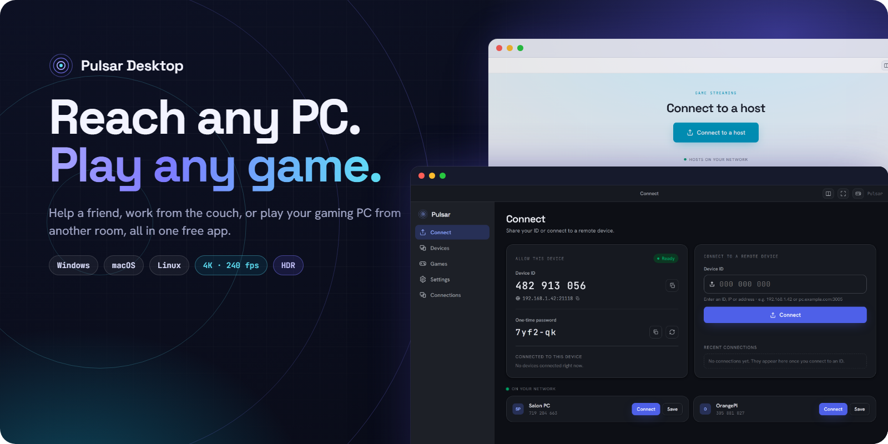
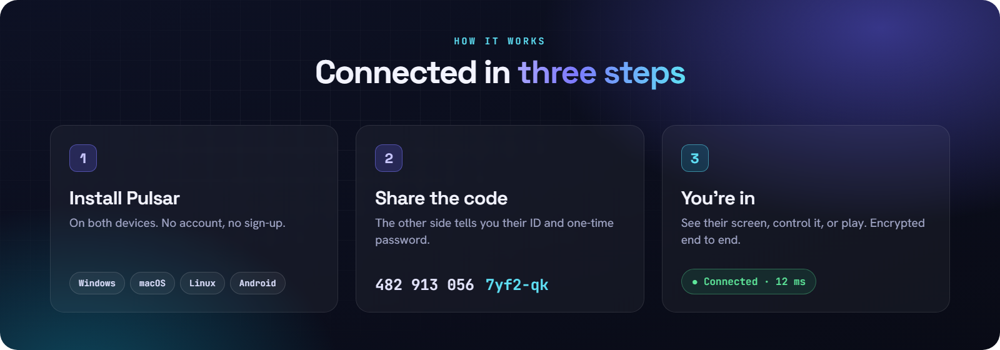
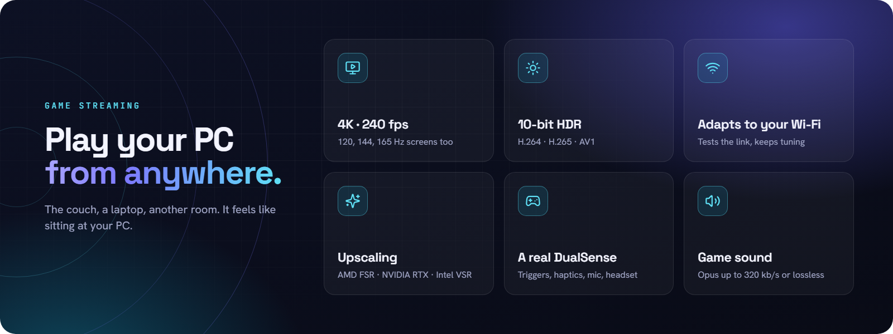
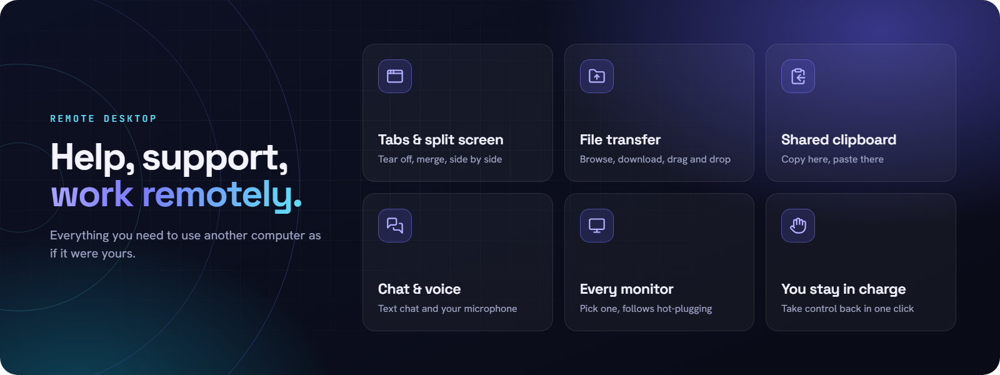
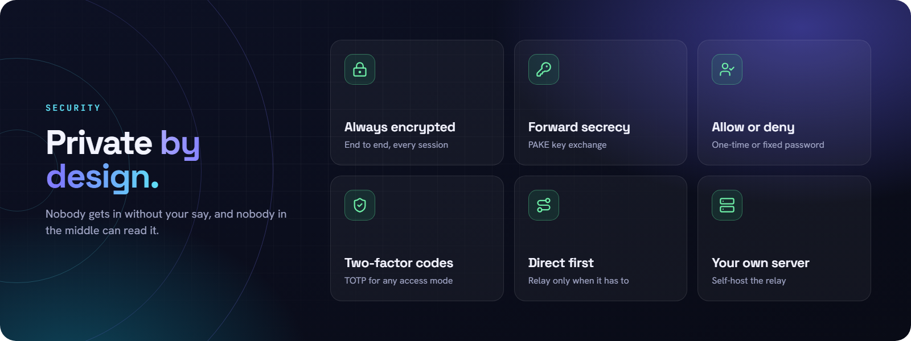
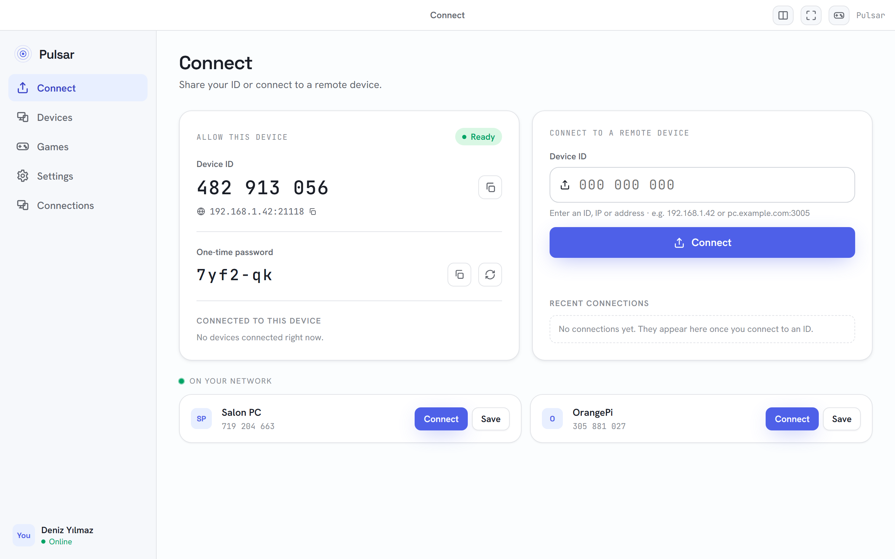
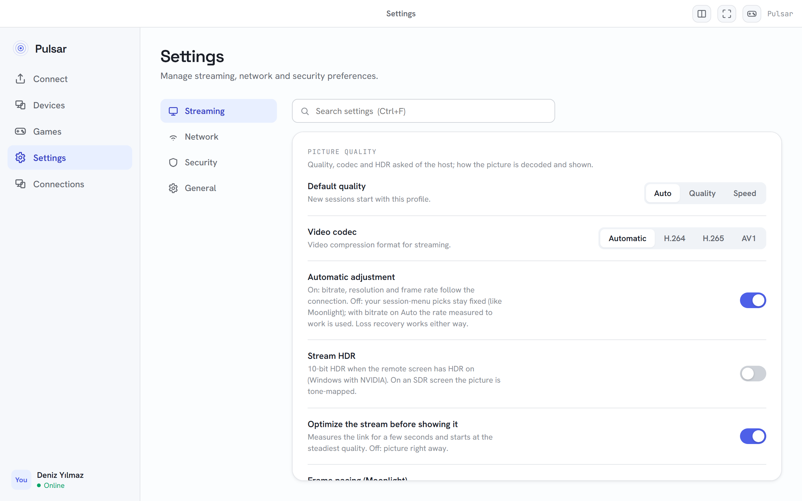

<p align="center">
  <a href="https://pulsardesk.com"></a>
</p>

<h3 align="center">Free, open-source remote desktop and game streaming.</h3>

<p align="center">
  The TeamViewer, AnyDesk and Parsec alternative with <b>no account</b>, <b>no subscription</b> and <b>no tracking</b>.
</p>

<p align="center">
  <a href="https://github.com/PulsarDesk/pulsar-desktop/releases/latest"></a>
  <a href="https://github.com/PulsarDesk/pulsar-desktop/releases/latest"></a>
  <a href="https://github.com/PulsarDesk/pulsar-desktop/releases/latest"></a>
  <a href="https://github.com/PulsarDesk/pulsar-mobile/releases/latest/download/Pulsar-android.apk"></a>
</p>

<p align="center">
  <a href="https://github.com/PulsarDesk/pulsar-desktop/releases"></a>
  <a href="https://github.com/PulsarDesk/pulsar-desktop/actions/workflows/ci.yml"></a>
  <a href="https://github.com/PulsarDesk/pulsar-desktop/releases"></a>
  <a href="https://github.com/PulsarDesk/pulsar-desktop/stargazers"></a>
  <a href="LICENSE"></a>
</p>

<p align="center"></p>

<p align="center"></p>

<p align="center"></p>

<p align="center"></p>

<p align="center"></p>

<table>
<tr>
<td width="50%"></td>
<td width="50%"></td>
</tr>
<tr>
<td width="50%"></td>
<td width="50%"></td>
</tr>
</table>

## 📥 Get Pulsar

| | Download from the [latest release](https://github.com/PulsarDesk/pulsar-desktop/releases/latest) |
|---|---|
| 🪟 **Windows** 10 / 11 | `_x64-setup.exe` (`_arm64-setup.exe` for ARM laptops) |
| 🍎 **macOS** | `_aarch64.dmg` (Apple Silicon), `_x64.dmg` (Intel) |
| 🐧 **Linux** | `.AppImage`, `.deb` or `.rpm` (x64, arm64) |
| 🍊 **Orange Pi 5** | `_opi5_arm64.deb` (Ubuntu 22.04 + `ppa:jjriek/rockchip-multimedia`) |

Or let [pulsardesk.com](https://pulsardesk.com) pick the right file. Pulsar updates itself.

> [!NOTE]
> The installers aren't signed yet. **Windows:** SmartScreen → *More info* → *Run anyway*.
> **macOS:** right-click → *Open* the first time. **Linux on Wayland:** the system asks once before sharing the screen.

## ❓ Questions

<details><summary><b>Is it really free?</b></summary><br>
Yes. Free and open source (GPLv3): no paid tier, no locked features, no "commercial use detected" pop-ups.
</details>

<details><summary><b>Do I need an account or open ports?</b></summary><br>
Neither. Each device gets an ID on its own, and Pulsar finds a way through home routers by itself. When no direct
path exists, it uses a relay automatically.
</details>

<details><summary><b>Can anyone else see my screen?</b></summary><br>
No. Every session is end-to-end encrypted, the relay only forwards data it can't read, and Pulsar sends no
telemetry.
</details>

<details><summary><b>Is it finished?</b></summary><br>
Not yet: Pulsar is in <b>alpha</b> (0.x). The main features work today, but expect rough edges and
<a href="https://github.com/PulsarDesk/pulsar-desktop/issues/new/choose">tell us what you hit</a>.
</details>

## 📚 More

<details>
<summary><b>🎮 Controllers</b></summary>

Plug any controller into the computer you connect **from** (USB or Bluetooth). The host's games see a virtual one:

| Your controller | What the host sees (Windows / Linux) |
|---|---|
| Xbox, Switch Pro, generic | Xbox 360 pad (no rumble yet) |
| DualShock 3 / 4 | DualShock 4 with rumble, touchpad and PS button (Windows; a generic pad without rumble on Linux) |
| DualSense | **a real DualSense**: adaptive triggers, HD haptics, lightbar, speaker, headset jack, mic, gyro, touchpad |

- Pick the virtual pad per controller in the Controllers panel; *Automatic* uses DualShock 4 for PlayStation pads.
- The PS / Xbox button brings Pulsar forward in game mode.
- The Windows installer adds the drivers (ViGEmBus, usbip-win2); Linux uses the kernel's `uinput` and `vhci-hcd`.
- Linux host: remote input needs write access to `/dev/uinput`. The .deb / .rpm install a udev rule
  (`70-pulsar-uinput.rules`); with the AppImage, click Pulsar's notice to install it.
- macOS hosts have no virtual controllers yet.
- Not tested yet: the DualSense mic, a USB-cabled DualSense on the connecting side, the DS4 headset jack.

</details>

<details>
<summary><b>🧪 Where it has been tested</b></summary>

| System | Share this computer | Connect to others |
|---|---|---|
| Windows 11, NVIDIA RTX | ✅ hardware (NVENC) | ✅ hardware |
| Windows 11 on ARM, Snapdragon | ✅ hardware (Media Foundation) | ✅ hardware |
| Windows 10, NVIDIA MX230 + Intel UHD | ✅ software | ✅ hardware |
| Linux (KDE Plasma, Wayland), AMD + NVIDIA | ✅ hardware | ✅ hardware |
| Raspberry Pi, Orange Pi 5 (RK3588) | ✅ | ✅ hardware on the Orange Pi 5 |
| Windows with AMD, Linux on GNOME / Intel, macOS | ❔ not tested yet | ❔ not tested yet |

Without a usable graphics card Pulsar falls back to software video. The `.AppImage` is checked on Fedora, Ubuntu,
Debian, openSUSE and Arch every release (Ubuntu 22.04 or newer); `Pulsar.AppImage --selftest` shows which encoders
work on your machine. Tried another system? A short [issue](https://github.com/PulsarDesk/pulsar-desktop/issues)
helps.

</details>

<details>
<summary><b>✨ Full feature list</b></summary>

- **Streaming:** 720p to 4K or the host monitor's own modes, 30 to 240 fps; H.264 / H.265 / AV1, 10-bit HDR;
  hardware encode and decode with software fallback; a native renderer; frames sent the moment they are captured;
  raw mouse input while a game holds the cursor.
- **Adaptive stream:** measures the link before the picture starts, then tunes bitrate, resolution, error
  correction (FEC) and loss recovery.
- **Upscaling:** AMD FSR, plus NVIDIA RTX / Intel Video Super Resolution on Windows.
- **Audio:** Opus up to 320 kb/s, or uncompressed on a local network; the host's speakers can stay silent.
- **Same-PC co-op:** split the screen, give each pane its own game window and controller.
- **Sessions:** tabs you can tear off and merge, split screen, multi-monitor, file manager, clipboard, chat,
  microphone, free cursor with the host's pointer labelled "Host", block control, switch sides.
- **Security:** PAKE with forward secrecy, one-time / fixed password, Allow / Deny, trusted devices, unattended
  access, TOTP two-factor.
- **Network:** NAT punching, UPnP / NAT-PMP, works over ZeroTier, Tailscale and other VPNs, relay fallback,
  [self-hostable relay](https://github.com/PulsarDesk/relay) (or `pulsar --relay`), LAN discovery.

</details>

<details>
<summary><b>🐞 Reporting a bug</b></summary>

[Open an issue](https://github.com/PulsarDesk/pulsar-desktop/issues/new/choose) and include:

- Pulsar version and your system on **both sides** (and X11 or Wayland on Linux)
- Graphics card on both sides
- What you did and what happened (black screen, no connection, crash, ...)
- The log file: Settings → General → **Open log folder**
- On Linux: the output of `Pulsar.AppImage --selftest`

</details>

<details>
<summary><b>🛠️ Build from source</b></summary>

**Needs:** Rust stable and [bun](https://bun.sh); on Linux also the GTK/WebKit and GStreamer development packages.

```bash
git clone https://github.com/PulsarDesk/pulsar-desktop.git
cd pulsar-desktop
bun install
bun run tauri dev        # run the app
bun run test:unit        # UI tests
```

More: [docs/development.md](docs/development.md). Issues and pull requests are welcome; commits follow
[Conventional Commits](https://www.conventionalcommits.org).

</details>

---

<p align="center">
  <a href="https://github.com/PulsarDesk/pulsar-mobile">📱 Pulsar Mobile</a> ·
  <a href="https://github.com/PulsarDesk/relay">🛰️ Pulsar Relay</a> ·
  <a href="https://github.com/PulsarDesk/pulsar-core">🧩 pulsar-core</a> ·
  <a href="https://pulsardesk.com">🌐 pulsardesk.com</a>
</p>

<p align="center">
  <sub>Free software under the <a href="LICENSE">GNU GPLv3 or later</a>. Like Pulsar? A ⭐ helps other people find it.</sub>
</p>
