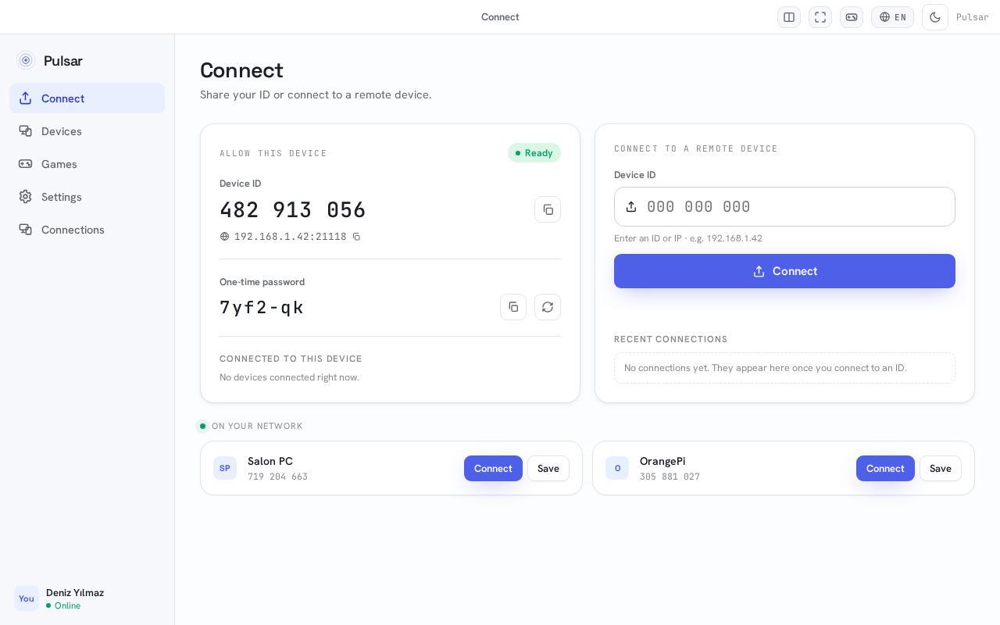
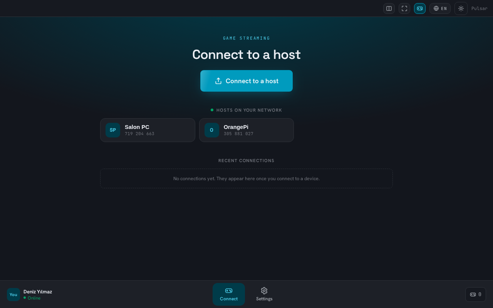

<p align="center">
  
</p>

<h1 align="center">Pulsar Desktop</h1>

<p align="center">
  Remote desktop and game streaming for <b>Windows, macOS and Linux</b>. A free, open-source alternative to TeamViewer, AnyDesk and Parsec. ⚡
</p>

<p align="center">
  
  <a href="https://github.com/PulsarDesk/pulsar-desktop/releases"></a>
  <a href="https://github.com/PulsarDesk/pulsar-desktop/actions/workflows/ci.yml"></a>
  <a href="LICENSE"></a>
</p>

---

## 🚀 Project Status
**Alpha (0.x).** Remote control, game streaming, file transfer, clipboard and chat work; expect rough edges and
[report what you find](#-reporting-a-bug).

<p align="center">
  
  
</p>

One app does both jobs: connect to another computer, or share this one. Connections go peer-to-peer when they can
and through a relay when they can't.

---

## ✨ Features

### 🎮 Game streaming
- **Up to 4K, up to 240 fps:** 720p / 1080p / 1440p / 4K or the host monitor's own modes, at 30 to 240 fps
  (120, 144, 165, 240 Hz panels included; capped by what the host monitor refreshes at).
- **Low latency:** hardware encoding on the host and hardware decoding on the client, the picture drawn by a native
  renderer (never the browser view), frames sent the moment they are captured, raw mouse input while a game holds
  the cursor.
- **H.264, H.265 and AV1**, plus **10-bit HDR** on supported displays. Software encode/decode as a fallback, so there
  is always a picture.
- **Optimized stream:** measures the link before the picture starts, then keeps tuning bitrate, resolution, error
  correction (FEC) and loss recovery, so a busy Wi-Fi or a phone hotspot stays playable.
- **Picture upscaling:** AMD FSR, plus NVIDIA RTX / Intel Video Super Resolution on Windows, so a lower stream
  resolution still looks sharp.
- **DualSense, for real:** the host sees a real DualSense: adaptive triggers, HD haptics, lightbar and LEDs,
  speaker, headset jack, microphone, gyro, touchpad, over USB or Bluetooth. Headphones in the pad get the game's
  sound, like on a PS5. Xbox, DualShock and Switch Pro pads work too ([details](#-controllers)).
- **Wake with a controller:** the PS / Xbox button brings Pulsar forward in game mode; controller input can keep
  flowing while another app is in front.
- **Game audio:** Opus up to 320 kb/s, or uncompressed on a local network. The host's speakers can stay silent while
  you play.
- **Same-PC co-op (advanced):** split the screen, give each pane its own game window and its own controller.
- **Small devices:** a dedicated Orange Pi 5 (RK3588) build with hardware decoding, usable as a living-room box.

### 🖥️ Remote desktop
- **Tabs like a browser:** every session is a tab; drag one out into its own window, drop it onto another window,
  or drag it onto the picture to show two sessions side by side.
- **Split screen:** several independent sessions in one window, to the same host or different ones.
- **Multi-monitor:** pick which host monitor to view; the list follows monitors being plugged in or removed.
- **File manager:** browse the other computer's files and download them, or drop files to send them.
- **Clipboard sync, chat and microphone** over the same session.
- **Free cursor:** leave the picture and the mouse is yours again; enter it and you control the other side. When
  the person at the host uses their own mouse, you see their pointer labelled "Host".
- **Block control:** the person at the host can take control back at any time with one click.
- **Switch sides:** turn a session around so the other person controls your computer, in one click.

### 🔒 Security and network
- **End-to-end encryption, always on:** password-authenticated key exchange (PAKE) with forward secrecy. The relay
  only ever sees encrypted traffic.
- **Access control:** one-time password, a fixed connect password, approve / deny on screen, trusted (paired)
  devices, unattended access, and two-factor authentication (TOTP) for any of them.
- **Peer-to-peer first:** direct connection with NAT punching and automatic router port opening (UPnP / NAT-PMP),
  works over ZeroTier, Tailscale and other VPNs, and falls back to the relay only when it has to.
- **Self-hostable relay:** run your own [relay](https://github.com/PulsarDesk/relay), or the same `pulsar` binary
  with `--relay`.
- **Finds devices on your network** without typing an ID.
- **Free and open source** (GPLv3): no account, no subscription, no telemetry.

---

## ⚡ Trying Pulsar
Download the installer for your system from the [latest release](https://github.com/PulsarDesk/pulsar-desktop/releases/latest):

| System | File |
|---|---|
| Windows | `_x64-setup.exe` (or `_arm64-setup.exe`) |
| macOS | `_aarch64.dmg` (Apple Silicon) or `_x64.dmg` (Intel) |
| Linux | `.AppImage`, `.deb` or `.rpm` (x64 and arm64) |
| Orange Pi 5 (RK3588) | `_opi5_arm64.deb`: hardware video decoding; needs Ubuntu 22.04 with the `ppa:jjriek/rockchip-multimedia` packages |

Open Pulsar, share your **ID and one-time password** with the other side, or type theirs to connect.

- **Windows:** not code-signed yet; if SmartScreen warns, choose "More info" -> "Run anyway".
- **macOS:** not notarized yet; right-click the app -> Open the first time.
- **Linux on Wayland:** the system asks once per session before your screen is shared.

---

## 📦 Other Pulsar Repositories
- [**pulsar-mobile**](https://github.com/PulsarDesk/pulsar-mobile) - Pulsar for Android
- [**relay**](https://github.com/PulsarDesk/relay) - Run your own relay server
- [**pulsar-core**](https://github.com/PulsarDesk/pulsar-core) - The shared engine behind both apps

---

## 🖥️ Where it has been tested
| System | Share this computer | Connect to others |
|---|---|---|
| Windows 11, NVIDIA RTX | ✅ hardware (NVENC) | ✅ hardware |
| Windows 11 on ARM, Snapdragon | ✅ hardware (Media Foundation) | ✅ hardware |
| Windows 10, NVIDIA MX230 + Intel UHD | ✅ software | ✅ hardware |
| Linux (KDE Plasma, Wayland), AMD + NVIDIA | ✅ hardware | ✅ hardware |
| Raspberry Pi, Orange Pi 5 (RK3588) | ✅ | ✅ hardware on the Orange Pi 5 |
| Windows with AMD, Linux on GNOME / Intel, macOS | ❔ not tested yet | ❔ not tested yet |

Without a usable graphics card Pulsar falls back to software encoding and decoding: slower, but there is always a
picture. The `.AppImage` is checked on Fedora, Ubuntu, Debian, openSUSE and Arch every release (Ubuntu 22.04 or
newer); `Pulsar.AppImage --selftest` shows which encoders work on your machine. Tried another system? A short
[issue](https://github.com/PulsarDesk/pulsar-desktop/issues) helps, even when everything worked.

---

## 🎮 Controllers
Plug any controller into the computer you connect **from** (USB or Bluetooth, read through SDL3). The host's games
see a virtual one:

| Your controller | Windows / Linux host |
|---|---|
| Xbox, Switch Pro, generic | Xbox 360 pad (no rumble yet) |
| DualShock 3 / 4 | DualShock 4 with rumble, touchpad and PS button (Windows; a generic pad without rumble on Linux) |
| DualSense | **a real DualSense**: adaptive triggers, HD haptics, lightbar, speaker, headset jack, mic, gyro, touchpad |

- Pick the virtual pad per controller in the Controllers panel; *Automatic* uses DualShock 4 for PlayStation pads.
- The Windows installer adds the drivers (ViGEmBus, usbip-win2); Linux uses the kernel's `uinput` and `vhci-hcd`.
  macOS hosts have no virtual controllers yet.
- Not tested yet: the DualSense mic, a USB-cabled DualSense on the connecting side, and the experimental DS4
  headset jack.

---

## 🐞 Reporting a bug
[Open an issue](https://github.com/PulsarDesk/pulsar-desktop/issues/new/choose) and include:

- Pulsar version and your system on **both sides** (Windows / macOS / Linux, and X11 or Wayland on Linux)
- Graphics card on both sides
- What you did and what happened (black screen, no connection, crash, ...)
- The log file: Settings -> General -> **Open log folder**
- On Linux: the output of `Pulsar.AppImage --selftest`

---

## 🛠️ Requirements
**To use:** Windows 10 or newer, macOS, or a 64-bit Linux (x64 or arm64). A graphics card with hardware video
encoding helps but is not required.

**For contributors / development:** Rust stable, [bun](https://bun.sh); on Linux also the GTK/WebKit and GStreamer
development packages.

---

## 🤝 Contributing
Everyone can open [issues](https://github.com/PulsarDesk/pulsar-desktop/issues) and pull requests. Irrelevant or
abusive issues may be closed or removed. Commits follow [Conventional Commits](https://www.conventionalcommits.org).

### Development Guide
```bash
git clone https://github.com/PulsarDesk/pulsar-desktop.git
cd pulsar-desktop
bun install
bun run tauri dev        # run the app
bun run test:unit        # UI tests
```

More: [docs/development.md](docs/development.md) (layout, encoders per platform, tests, releases).

---

## 📄 License
Pulsar is licensed under **GNU GPLv3 or later** (GPL-3.0-or-later). See the [LICENSE](LICENSE) file for details.
